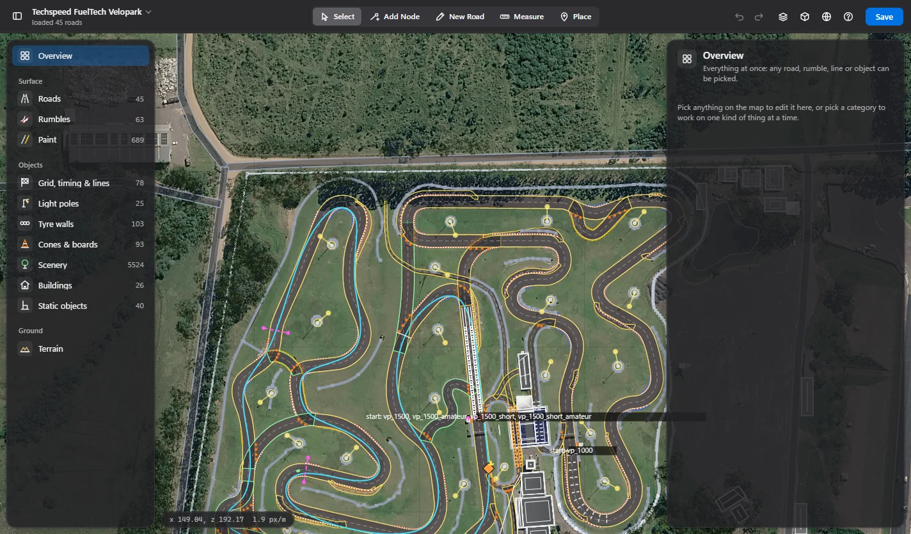
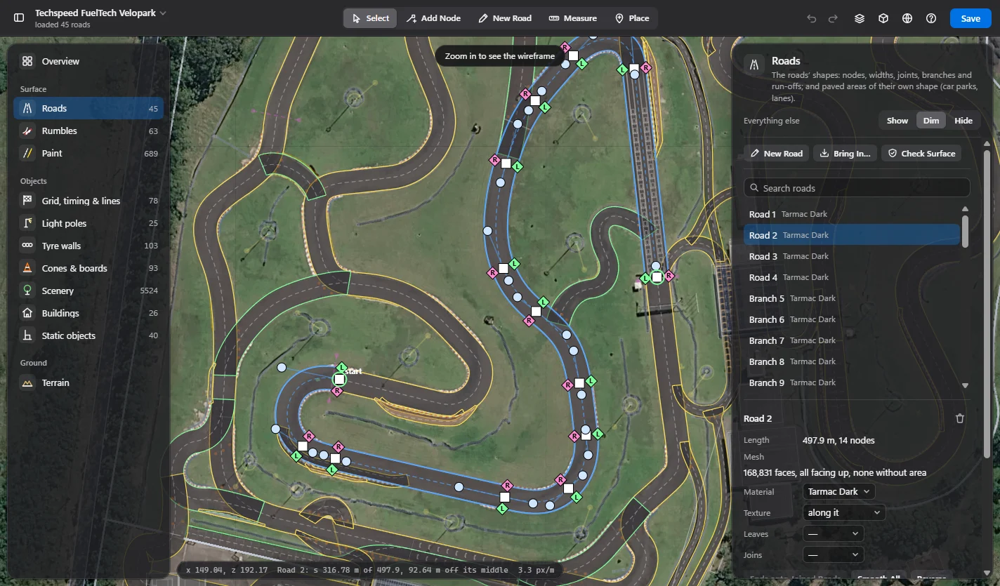
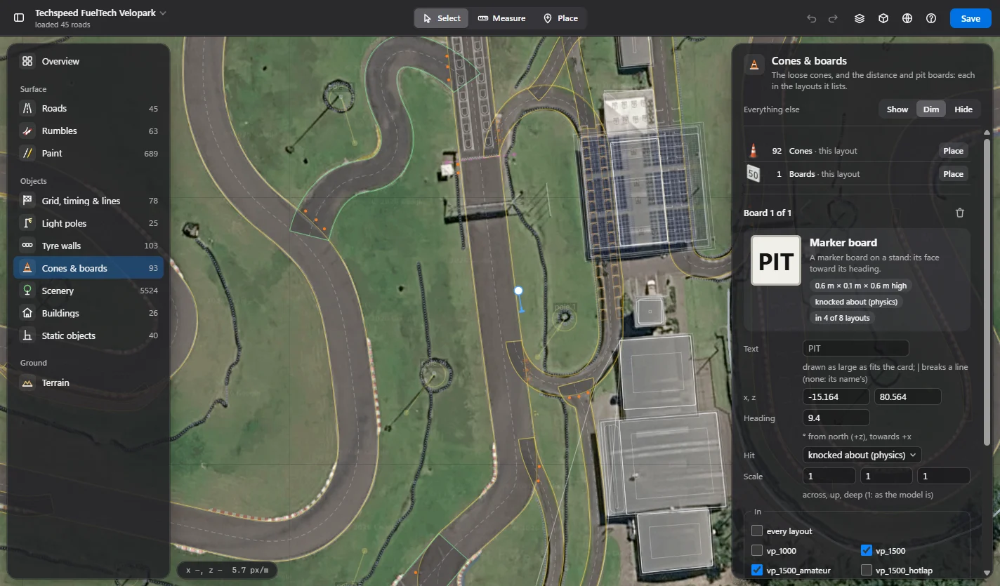
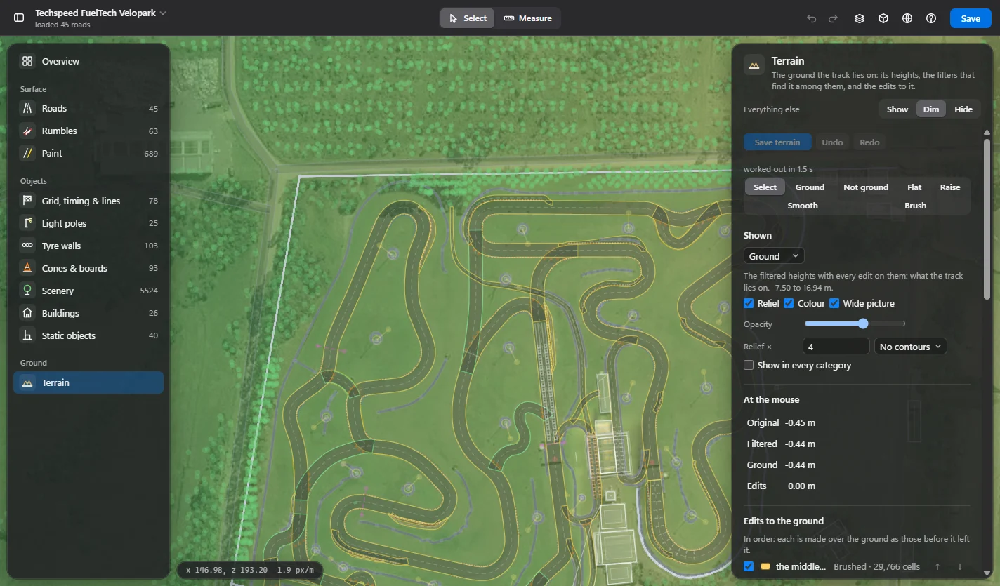
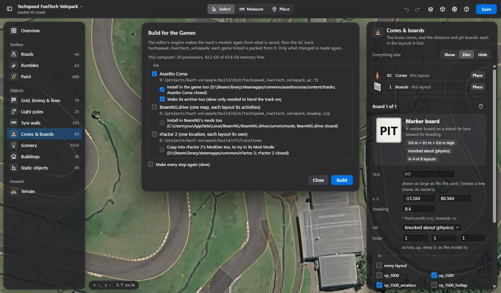

# Top Race editor

Draw a race track over its satellite picture, place everything around it, and build it for **Assetto Corsa**,
**BeamNG.drive** and **rFactor 2** from one place.



You edit the track the way you see it from above: roads as curves you drag into shape, rumbles and paint along
them, and the grid, pits, timing gates, cones, boards, light poles, tyre walls, trees and buildings where they stand.
The editor works out the ground, the meshes and the AI lines, and one click builds the track for each game, and
installs it if you want.

- [Getting started](#getting-started)
- [The window](#the-window)
- [Roads](#roads)
- [Rumbles and paint](#rumbles-and-paint)
- [The grid, timing and racing lines](#the-grid-timing-and-racing-lines)
- [Objects](#objects)
- [The terrain](#the-terrain)
- [Saving](#saving)
- [Building for the games](#building-for-the-games)
- [Making a new track](#making-a-new-track)
- [Keys and mouse](#keys-and-mouse)
- [When something goes wrong](#when-something-goes-wrong)

## Getting started

**What you need**

- Windows 10 or 11.
- A track's folder: one the editor made (see [Making a new track](#making-a-new-track)), or the Techspeed FuelTech
  Velopark (`kart-velopark`) next to the editor.
- The games you build for, installed, if you want the editor to install the track in them.

**Install and open it**

Run the installer (`top-race-editor-<version>-win-x64.exe`) and open **Top Race Editor** from the Start menu. The first time, it
opens the Velopark if it sits next to the editor; after that, the track you had open last.

<details>
<summary>Running it from its source instead</summary>

With [Node.js](https://nodejs.org) 20 or later:

```sh
npm install
npm start
```

`npm start -- --project <folder>` opens a given track. [DEVELOPMENT.md](DEVELOPMENT.md) has the rest.
</details>

**Open another track** from the track's name at the top left: it lists the tracks it found and the ones opened
before, and takes any track's folder.

## The window



- **The toolbar** (top): the tools for what you're working on (Select, Add Node, New Road, Measure, Place), Undo and
  Redo, what the map shows (the layers button), Build for the games, New Track, Help, and **Save**.
- **The categories** (left): pick what to work on: Roads, Rumbles, Paint, Grid, timing & lines, Light poles, Tyre
  walls, Cones & boards, Scenery, Buildings, Static objects, Terrain. In a category only its own things can be
  picked, and the rest of the map is shown, dimmed or hidden (**Everything else**, top of the inspector).
  **Overview** lets you pick anything. Keys `1` to `9`, `0`, `-` and `=` switch between them; `\` hides the sidebar
  for more map.
- **The map** (middle): wheel to zoom at the cursor; drag empty map, or drag with the right or middle button, to pan.
  The bar at the bottom says where the cursor is, and on a road, how far along it you are.
- **The inspector** (right): what you picked, and the category's own tools.

## Roads

Click a road to pick it. Its marks show:

| Mark                           | What dragging it does                                                                      |
| ------------------------------ | ------------------------------------------------------------------------------------------ |
| White square: a **node**       | moves the road through there (it snaps to other roads' ends and edges; hold `Ctrl` not to) |
| Blue dot: a **handle**         | bends the curve at its node; the other handle follows. `Alt` + drag for a sharp corner     |
| `L` / `R` diamond: a **width** | that side's width at the node; `Shift` changes both sides                                  |

The marks are large and grabbed from a little way off, so you can work without zooming in close. Where marks crowd
together, the one nearest the cursor is taken.

- **Add a node:** `A` then click on the road, or double-click it. Click past an end to make the road longer.
- **New road:** `N`, click its points, then `Enter`.
- **Join two roads:** `J` on a road's first or last node joins it to the nearest end of another road.
- **Smooth:** `S` smooths the picked node, or the whole road with no node picked.
- **Delete:** `Delete` takes out the picked node; `Shift`+`Delete` the whole road.
- **Bring In** (Roads category) adds a road the track has but the editor doesn't yet, from its mesh.
- **Bumps** (`U`) makes the road surface less than perfect, by hand. **Point**: pick a road to show its mesh's
  points (zoom in), then drag one up or down (`Shift` for finer steps) or type its bump in millimetres; it eases to
  nothing within its reach. **Raise**, **Lower** and **Smooth** are brushes you drag over the road. The map shows
  the bumps in red (up) and blue (down). The build moves the merged surface by them, so the paint, rumbles, objects
  and racing lines follow, in every game. They are saved with the track (`source/bumps.json`); **Clear All Bumps**
  takes them away.
- **Check Surface** (`C`) builds the ground where you're looking, as the build will, and rings any seam problem in
  red.

The road's form gives its length, material, its texture's direction, and its joints, branches and run-offs.

## Rumbles and paint

Pick a road, then **Rumbles** or **Paint** to see what runs along it. Drag a rumble or a line to slide it along the
road, and its end (an orange triangle) to make it start or end elsewhere. Their forms set the kind, width and
colour.

**Paint Marks** (in Paint) holds paint that isn't along one road: start lines, the grid's boxes and the pit
boxes' marks, and lines across a road. **Paint Round** paints round a layout's grid slots or pit boxes as they
stand.

A paint mark is a curve, like a tyre wall: drag its nodes and handles, `A` adds a node, `S` smooths it. To paint one,
**Place** and drag from its start to its end, then click on to carry it on; drag again for a new one. A node dragged
near another mark's end snaps onto it (hold `Ctrl` not to).

The paint merges where it meets, on the map and in the game. Lines of the same paint whose ends meet, whether
marks or roads' edge lines, are painted as one line with mitred corners. A road's edge line joins the next road's,
and lines that close a loop become one closed ring, such as a rectangle round a box or a triangle where roads fork.
Where two paints meet end to end (a yellow line and a white one, or two widths), they join at a mitred seam, each
keeping its half of the corner. Where paint overlaps, it is painted once.

**Wear** (top of Paint) sets how worn all the painting looks in the game: lines, marks, boxes and start lines.
Choose **New**, **Almost new**, **Used** or **Very used**. Even new paint is a little dull, with the asphalt's grain
showing through it. The more it is used, the thinner and dirtier it gets, and the more it wears off in patches.

**Rubber** (in Paint) holds the dark rubber the cars leave on the roads. Like the paint, it is the track's: every
layout shows all of it. A rubber mark is a curve, edited like a paint mark: **Place** and drag to lay one, drag its
nodes and handles, `A` adds a node, `Delete` takes it away. Each one has its own width and darkness (**Almost new**,
**Used** or **Very used**). The build lays the rubber the way cars would: the most in the braking zones, through the
apexes and out of the corners, little on the straights. It is drawn as thousands of separate tyre marks laid over time
(most old and faded, a few fresh and dark), the asphalt's stones showing through, and marbles thrown outside the
corners, never a repeating picture. **New rubber** sets how dark new marks start. **Lay Rubber Along the Racing
Lines** copies the layout chosen at the top's fast line and pit lane in as rubber marks (`RUBBER_<LAYOUT>_FAST`,
`_PIT`), which you can then trim, move or delete. Doing it again for the same layout replaces them. Draw a rubber mark
the way the cars drive. Where marks lie over one another, as layouts sharing a corner do, the road shows them as one,
never darker than the darkest of them, so every layout's lines can stay.

**To merge two lines**, drag one's end onto the other's: a line's end (its orange triangle) or a mark's node snaps
onto the end of any other line or mark nearby (hold `Ctrl` not to). Ends within 10 cm of each other merge by
themselves.

## The grid, timing and racing lines

Each **layout** (vp_1000, vp_1500…) has its own grid, pit boxes, hotlap start, timing gates and racing lines. Choose
the layout at the top of the panel. **with the same** changes every layout that has the same set at once.

- **Lay Out Along a Line** puts a whole grid or row of pit boxes down at once: how many, in rows of 1, 2 or 3, how far
  apart, and which way they face. Click where the first one stands, then the way the rest go.
- **Timing gates** are two posts; drag either.
- **The racing line and the pit lane** are curves like a road's middle. The games' AI drives these lines. The pit
  lane leaves and joins the racing line at its two diamonds; drag them along the line to move where the cars go in
  and come out.
- **In Assetto Corsa the pit lane must run the same way as the layout.** AC can't take a pit lane the cars drive
  against the racing line's direction, so lay it out going the way the track goes.
- **Start lines** (in Paint) are painted on the track for every layout, chequered or a solid line.
- **Rubber** is the track's, not a layout's: it is in Paint, where a layout's racing lines can be copied in as rubber.
- **Cars' width** is what the AI lines are made for (1.4 m unless you set it). The AI keeps half of it,
  and 0.3 m more, off the road's edges. It may run over a rumble's low ramp, but not over concrete (a concrete
  rumble, the concrete behind a ramp) nor off a rumble's back, where a car would be thrown.

## Objects



Light poles, tyre walls, cones and boards, scenery (trees, fences), buildings and static objects are all placed the
same way:

1. Pick the category, then **Place** beside the kind (or press `O`). Where a kind has several models, choose one by
   its picture first.
2. Click on the map to put one down. It faces the way the last one did, or along the nearest road.
3. Drag it to move it; drag its white handle to turn it. `Shift` moves or turns all of its kind in the layout.

**What you picked** shows at the top of the inspector: its picture, what it is, its size, how it's hit (not at all,
a box round it, a wall along it, or knocked about), and which layouts have it. Below that is its form: where it stands, its heading, its
scale and its layouts.

**To find one**, pick it on the map, or open **Find one in the list** and search by its name. The list stays shut
until you need it, so what you picked has the room.

**Marker boards** say whatever you type in their **Text**, drawn as large as fits the card (`|` starts a second
line). Left empty, a board says what its name does: `BOARD_PIT` says PIT.

**Tyre walls and fences** are curves: drag their nodes and handles like a road's, `A` adds a node, and `S` smooths
it. The build lays the stacks or panels along the curve.

## The terrain



The **Terrain** category edits the ground the track lies on. **Shown** chooses what the map shows: the heights as
measured, the ground once trees and roofs are filtered out, the ground with your edits, or just the edits.

- **Filters** tell the ground from the tops of trees and buildings. Draw areas that are, or aren't, the ground
  whatever the filters find.
- **Edits** change the ground, each over the ones before it: **Flat**, **Raise** and **Smooth** areas, and the
  **Brush** (raise, lower, smooth, or flatten to a height; `Alt`-click takes the height under the cursor).
- **Save terrain** (or `Ctrl`+`S` while in Terrain) keeps the terrain; the next build starts from it.

**Ground** chooses the picture the games show on the ground: **The photo** (the satellite picture as it is) or
**Generated from it**. Use the generated one when the photo may not be handed on, as with Google's pictures. The
build reads the photo only to find what covers the ground where (grass, earth, paving) and the colour of each over
every few metres. It then paints those shapes with textures of its own, so none of the photo's detail and none of its
tree shadows end up in the games. Up close in Assetto Corsa the ground has a texture of its own on top: grass blades,
sand with pebbles, or gravel, depending on what covers it. The editor keeps showing the photo, so you still edit over the real place. The
generated picture is made once, and made again when the photo changes.

## Saving

**Save** (`Ctrl`+`S`) writes your roads and objects to the track's folder; the one before goes to its backups.
`Ctrl`+`Z` and `Ctrl`+`Y` undo and redo. Closing with changes not saved asks whether to save them first.

## Building for the games



**Build for the games** (the box in the toolbar) makes the track for the games you tick. It saves your changes
first, then makes the track's models and each game's track from them. Only what changed is made again, so a second
build is quicker.

- **Assetto Corsa:** every layout, with its AI lines, pit boxes and lights. Tick **Install in the game too** to copy
  it into AC's tracks folder (close AC first). **Make its archive too** packs a `.7z` to hand the track on.
- **BeamNG.drive:** one map with every layout's races; **Install in BeamNG's mods too** puts it in your mods
  folder. You can spawn at every layout's start, or only at those the track file lists in `beamng.spawns`; every
  layout keeps its races either way.
- **rFactor 2:** one location, each layout its own, with its cones and boards knocked about as in the other games.
  **Copy into rFactor 2's ModDev too** puts it there to try in Mod Mode (close rFactor 2 first).

Each layout's pictures are renders of the built track, as the games' own tracks have, with the grass AC grows near
the camera. A layout's picture shows the start gantry its lap runs under, seen from the track before it. A layout
whose lap runs under no gantry is shown whole, from above at a slant. AC uses it as the layout's preview and draws
the layout's outline over it (`outline.png`, drawn from its racing line). BeamNG uses it for the layout's spawn, race
and time trial. rFactor 2 gets pictures like its own tracks': each layout's icon and thumbnail of its lap, its map for
the wheel's screen, and a loading screen (the track seen from its start, with its data and its map over it). The
location's icon is the track with every layout's roads drawn over it.

The dialog shows each stage, how long it may still take, and the log. You can close it and keep working while it
builds. A track builds only when every layout is whole: its racing lines, grid, pits, timing gates and hotlap start.

Tracks can also be built with no window, for an automatic build:
`npm run build-track -- --project <folder> [--games ac,beamng,rf2] [--install]`. See
[DEVELOPMENT.md](DEVELOPMENT.md#from-the-command-line-ci).

## Making a new track

**New Track** (the globe in the toolbar) makes a new track's folder:

1. **Its place:** search for it by name, or click the map. That point is the track's centre.
2. **The area round it**, in metres.
3. **Its picture:** Esri World Imagery (free, no key), Mapbox or Google; and how sharp.
4. **Its heights:** AWS Terrain Tiles (free, no key), Mapbox Terrain or Google Elevation.
5. **Its name and folder.**

Before it starts, the wizard says how many pictures and heights it will fetch. Mapbox and Google need your own API
key; it is kept on this computer only, never in a track. When it's done, open the new track from the track's name at
the top left. It has its ground but no roads yet: draw them with **New Road**.

## Keys and mouse

| Keys                                          | What they do                                       |
| --------------------------------------------- | -------------------------------------------------- |
| `1`–`9`, `0`, `-`, `=`                        | switch category                                    |
| `\`                                           | show or hide the sidebar                           |
| Wheel / right or middle drag / `Space` + drag | zoom / pan                                         |
| `A` then click, or double-click               | add a node to what's picked                        |
| `N`, clicks, `Enter`                          | a new road                                         |
| `J`                                           | join a road's end to the nearest other road        |
| `S`                                           | smooth the picked node, or the whole road or curve |
| `O`                                           | place the kind chosen                              |
| `M` then drag                                 | measure                                            |
| `U`                                           | bump the roads' surface by hand                    |
| `C`                                           | check the surface where you look                   |
| `Delete` / `Shift`+`Delete`                   | delete the picked node or object / the whole road  |
| `Esc`                                         | back to Select, nothing picked                     |
| `Ctrl`+`Z` / `Ctrl`+`Y` / `Ctrl`+`S`          | undo / redo / save                                 |
| `?`                                           | all the keys and mouse actions                     |

## When something goes wrong

- **"Assetto Corsa is running: close it before installing."** Close the game (Content Manager can stay open) and
  build again. The same goes for BeamNG.drive and rFactor 2.
- **The satellite picture is late** just after opening a track: the editor is working the ground out first. It
  fills in on its own a few seconds later.
- **The build stops with a layout not whole:** the message names the layout and what it lacks (a racing line, a
  grid…). Add it in Grid, timing & lines and build again.
- **Something looks wrong in the game but right in the editor:** tick **Make every step again** in the Build dialog
  and build once more.
